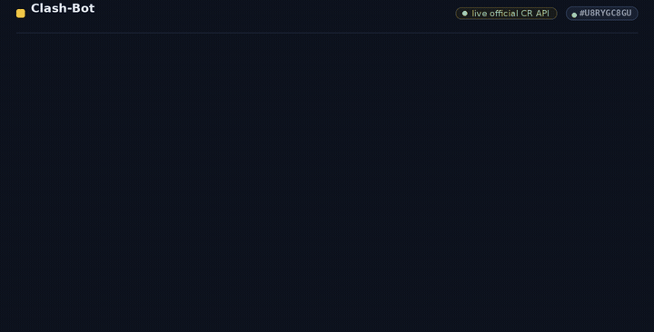

# Clash-Bot


Clash-Bot is an API backend for LLM-powered chat app built for Clash Royale players.
Using tool-calls with LLMs it retrieves real-time data from the official Clash Royale API to provide accurate, up-to-date answers to players' questions.



One of the main ways Clash Royale players check their or other players' in-game stats, battle history and other infromation is through RoyaleAPI website with a player tag. Finding specific information requires navigating through multiple pages, their sections and endless buttons. Clash-Bot makes this process faster and more natural. Players can simply ask questions in a chat and get answers from LLM with accurate data.

## Architecture

```text
clash-bot/
├── cmd/
│   ├── api/              # Server entry point
│   └── worker/           # RabbitMQ consumer that generates LLM replies
├── internal/
│   ├── broker/           # Message Broker interface
│   ├── clash/            # Clash client interface
│   ├── data/             # Database models and data access
│   ├── llm/              # LLM client interface and tool calls
│   ├── mocks/            # Generated mocks for tests
│   ├── objectstorage/    # Object Storage Client interface
│   └── validator/        # Validation helpers
├── migrations/           # Database schema migration files
├── e2e/                  # End-to-end tests
├── Dockerfile            # API and worker container images
├── docker-compose.yml    # Local Postgres, Redis, RabbitMQ, API and worker
├── Makefile              # Common development commands
└── README.md             # Project documentation
```

## Endpoints

### Health & Metrics

- `GET /health` - Check application health.
- `GET /debug` - Retrieve application metrics.

### Auth

- `POST /v1/auth/login` - Authenticate and receive an access token and refresh token.
- `POST /v1/auth/refresh` - Get a new access token using a refresh token.
- `POST /v1/auth/logout` - Revoke a refresh token.

### Users

- `POST /v1/users` - Create a user account.
- `GET /v1/users/:id` - Retrieve the authenticated user's profile.
- `PATCH /v1/users/:id` - Update the user's username, password, or game tag.
- `DELETE /v1/users/:id` - Delete the authenticated user.
- `POST /v1/users/:id/profile-picture` - Upload a profile picture (JPEG or PNG).

### Chats

- `GET /v1/chats` - List the authenticated user's chats with pagination, name filtering, and sorting.
- `POST /v1/chats` - Create a chat.
- `GET /v1/chats/:id` - Retrieve a chat.
- `PATCH /v1/chats/:id` - Update a chat's name.
- `DELETE /v1/chats/:id` - Delete a chat.

### Messages

- `GET /v1/chats/:id/messages` - List messages in a chat with pagination and sorting.
- `POST /v1/chats/:id/messages` - Send a user message; the worker generates the assistant reply asynchronously.

## Run locally with docker

1. Copy `.env.example` to `.env`.

   Fill in these values:

   ```
   GEMINI_API_KEY=
   CLASH_ROYALE_API_TOKEN=
   R2_ACCESS_KEY=
   R2_SECRET_ACCESS_KEY=
   R2_BUCKET=
   R2_PUBLIC_URL=
   S3_API_ENDPOINT=
   ```

2. Start everything:

   ```
   docker compose up --build
   ```

3. Stop and remove everything:

   ```
   docker compose down -v
   ```
